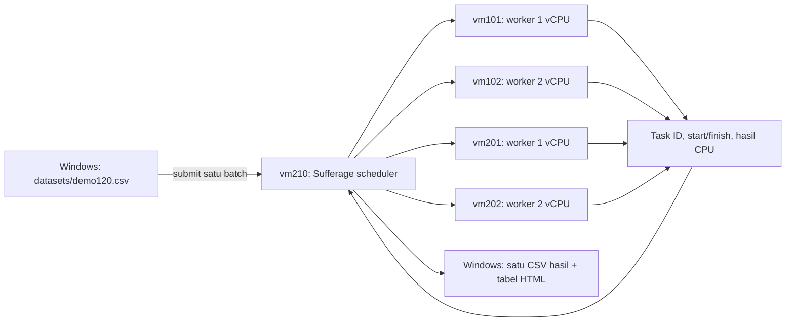

# Sufferage Task Scheduler

Penjadwalan **task batch statis** pada empat VM worker nyata. Windows membaca
dataset CSV, vm210 menghitung jadwal Sufferage, lalu mengeksekusi task pada antrean
masing-masing worker. HTTP dipakai untuk kontrol dan RPC eksekusi task.

**Mulai dari [urutan demo](docs/DEMO.md)**, [arsitektur](docs/ARSITEKTUR.md),
[algoritma dan metrik](docs/SUFFERAGE.md), serta [laporan verifikasi](docs/LAPORAN.md).

## Alur



## Demo dari Windows

Setelah seluruh VM siap:

```powershell
cd E:\testsokarealworld
curl.exe --noproxy '*' http://192.168.56.10/api/health
.\windows\demo_scheduler.ps1
```

Script mengkalibrasi ETC di luar waktu batch, mengirim 120 task, menunggu seluruh
antrean selesai, lalu menyimpan `results/pengujian N.csv` dan memperbarui
`hasil_pengujian.html`. Tidak memakai Locust atau UI port 8089.
Dataset demo standar: 120 task (60 ringan, 36 sedang, 24 berat), urutan acak seed 42.
Pilihan 240 dan 500 task juga tersedia; [lihat komposisi dataset](datasets/README.md).
Dataset 40 task tetap disimpan untuk referensi hasil verifikasi sebelumnya.
Task ID, urutan dan ukuran sama pada pengujian ulang.

### Pilih jumlah task

Jalankan dari `E:\testsokarealworld`, satu batch pada satu waktu:

```powershell
# 120 task: 60 ringan, 36 sedang, 24 berat (default)
.\windows\demo_scheduler.ps1

# 240 task: 120 ringan, 72 sedang, 48 berat
.\windows\demo_scheduler.ps1 -Dataset datasets\demo240.csv

# 500 task: 250 ringan, 150 sedang, 100 berat
.\windows\demo_scheduler.ps1 -Dataset datasets\demo500.csv
```

Setiap perintah di atas mengkalibrasi ulang ETC sebelum batch. Untuk mengulang
pengujian dengan ETC yang sama, tambahkan `-ReuseCalibration`, misalnya:

```powershell
.\windows\demo_scheduler.ps1 -Dataset datasets\demo240.csv -ReuseCalibration
```

Tunggu batch selesai sebelum menjalankan perintah berikutnya. Task yang lebih
banyak menambah waktu planning dan eksekusi pada laptop emulasi.

Terminal lain untuk membuktikan eksekusi pada vm210:

```powershell
ssh root@192.168.56.10
```

```sh
hostname
rc-service task-scheduler status
tail -f /var/log/sufferage-scheduler/service.log
```

## Kode utama

| Folder/file | Fungsi |
|---|---|
| `vm210/sufferage.py` | Algoritma Sufferage memakai matriks ETC |
| `vm210/scheduler.py` | API batch, antrean per worker, eksekusi dan metrik |
| `vm210/openrc/` | Autostart service `task-scheduler` |
| `backends/worker/` | Perhitungan CPU nyata, proses sesuai kapasitas VM |
| `datasets/demo120.csv` | Dataset input yang dapat diperiksa |
| `windows/demo_scheduler.ps1` | Perintah demo utama |
| `windows/run_scheduler.py` | Pengirim dataset dan pemantau progress |
| `windows/scheduler_report.py` | CSV lengkap dan HTML hasil scheduling |
| `monitoring/` | Utilisasi CPU/RAM guest |
| `scripts/install_scheduler.py` | Memasang scheduler pada vm210 |
| `tests/test_scheduler.py` | Tes matematika, antrean, metrik dan hasil |
| `legacy/` | Arsip lokal pendekatan HTTP lama, diabaikan Git; versi lama tetap ada di riwayat commit |

## Metrik evaluasi

- Makespan: waktu dari batch diterima sampai eksekusi antrean terminal.
- Waiting time: task mulai dieksekusi dikurangi arrival (semua arrival = 0).
- Turnaround time: task selesai dikurangi arrival.
- Throughput: task sukses / makespan dalam detik.
- Success rate, task gagal/skipped, distribusi alokasi worker.
- CPU/RAM rata-rata dan puncak kelima guest VM, beserta cakupan sampel.

CT memakai `ready_time worker + ETC[task,worker]`. ETC v2 adalah median tujuh sampel durasi RPC scheduler–worker setelah warmup
seluruh jenis task, dengan urutan campuran dan pemantauan resource aktif. Task pada satu worker tidak tumpang tindih secara
logis; worker dua vCPU membagi satu task ke dua proses. Task independen dan
non-preemptive. Sufferage heuristik, tidak dijanjikan optimal.

## Instalasi pada clone

```powershell
python -m venv .venv
.\.venv\Scripts\python.exe -m pip install -r windows\requirements.txt
.\.venv\Scripts\python.exe scripts\install_task_workers.py
.\.venv\Scripts\python.exe scripts\install_scheduler.py
```

Client batch/report hanya membutuhkan stdlib Python. Paramiko untuk installer.
Pada lab ini worker dan scheduler dipasang langsung, jadi demo tidak perlu install ulang.
Installer menonaktifkan autostart layanan lama `sufferage-lb`; service aktif sekarang
`task-scheduler`. Cluster, IP, hostname, bridge dan disk tidak diubah.

## Mengulang dengan ETC yang sama

```powershell
.\windows\demo_scheduler.ps1 -ReuseCalibration
```

Untuk mengambil hasil batch yang sudah dikirim tanpa mengeksekusi ulang:

```powershell
.\windows\demo_scheduler.ps1 -Resume latest
```

Hasil HTTP lama tidak digabungkan ke tabel scheduling. Tidak ada password, token,
disk VM, virtual environment atau CSV hasil mentah yang diunggah. Untuk pengujian
akhir, ulangi dataset dan ETC yang sama minimal tiga kali dan laporkan variasinya.

## Kualitas ETC dan efisiensi planning

Versi aktif `rpc-median7-v2` menyimpan tujuh sampel RPC per jenis/worker beserta
median, p90 dan CV. Median tahan terhadap sebagian outlier, tetapi kontensi laptop
tetap dapat mengubah waktu aktual. Tabel hasil menampilkan MAPE prediksi eksekusi,
unit kerja, waktu selesai dan jeda akhir tiap worker. Resource tidak dipaksa sama.

Planner mengelompokkan task dengan baris ETC identik (jenis sama). Hanya task
paling awal dari tiap jenis yang perlu dievaluasi pada setiap langkah karena
nilai Sufferage-nya identik. Tes differential memastikan seluruh alokasi, CT dan
tie-break sama dengan perhitungan semua task, hingga batch 500 task. Ini optimasi
perhitungan, bukan perubahan algoritma penjadwalan.

## Menghapus hasil pengujian lokal

Dari akar proyek, lihat daftar hasil terlebih dahulu (opsional):

```powershell
cd E:\testsokarealworld
.\windows\hapus_hasil.ps1 -Preview
```

Untuk menghapus CSV `results/pengujian N.csv` dan membuat ulang halaman HTML hasil kosong:

```powershell
.\windows\hapus_hasil.ps1
```

Pengujian berikutnya mulai dari `pengujian 1.csv`. Refresh `hasil_pengujian.html`
setelah pembersihan. Dataset input, kode, kalibrasi dan log hasil pada VM210 tetap
tersimpan. Script menolak pembersihan ketika client pengujian lokal atau batch
scheduler masih aktif. Tutup Excel jika CSV sedang dibuka.

## Mengosongkan service log sebelum demo

Lakukan setelah pengujian selesai. Masuk ke VM210 dari PowerShell:

```powershell
ssh root@192.168.56.10
```

Di terminal SSH VM210, kosongkan isi log:

```sh
truncate -s 0 /var/log/sufferage-scheduler/service.log
```

Service tetap berjalan dan menulis log baru. CSV hasil pengujian dan dataset tetap
tersimpan. Perintah ini menghapus isi log lama secara permanen; jalankan hanya jika
log tersebut sudah tidak diperlukan. Script Windows `hapus_hasil.ps1` hanya
membersihkan hasil lokal dan tidak menjalankan perintah ini.

Untuk melihat log baru saat demo:

```sh
tail -f /var/log/sufferage-scheduler/service.log
```

Tekan `Ctrl+C` untuk berhenti menampilkan log; service scheduler tetap berjalan.
