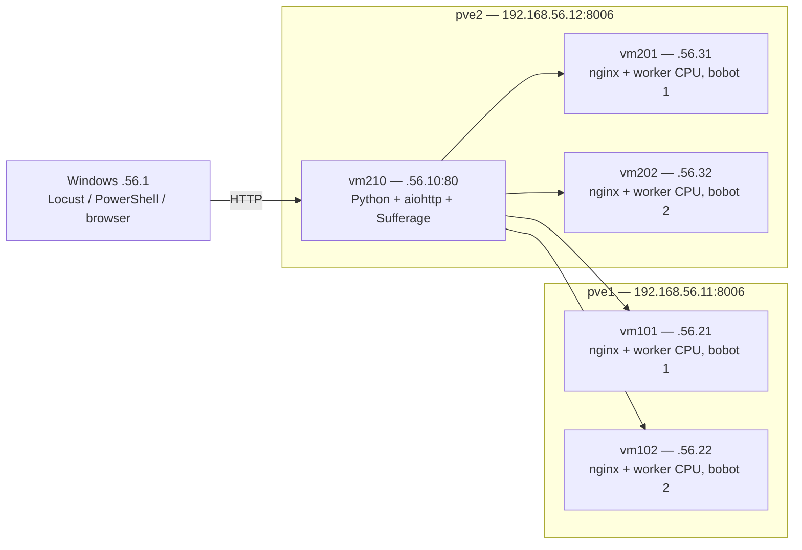

# Sufferage HTTP Load Balancer

Proyek tugas kuliah: load balancing HTTP menggunakan heuristik **Sufferage** pada
empat backend nginx + worker CPU ringan/sedang/berat. LB berjalan di **vm210** dan trafik pengujian dibuat oleh
**Locust di Windows**. Operasional demo menggunakan Sufferage dengan autostart OpenRC.

## Mulai membaca dari sini

1. [Arsitektur: isi host dan setiap VM](docs/ARSITEKTUR.md).
2. [Langkah demo: nyalakan → cek LB → Locust → lihat output](docs/DEMO.md).
3. [Cara kerja Sufferage dan fungsi kodenya](docs/SUFFERAGE.md).
4. [Instalasi dan lokasi file layanan vm210](docs/INSTALASI.md).

## Arsitektur singkat



Alamat pendek `.56.x` pada diagram berawalan `192.168`. Dua node Proxmox ini
merupakan VM VirtualBox pada satu laptop fisik. Algoritma membagi **request HTTP**;
Proxmox mengelola VM. Tidak ada migrasi VM oleh algoritma ini.

## Demo cepat dari Windows

Jalankan dari akar repo setelah semua VM selesai boot. Pada laptop yang sudah
dikonfigurasi, LB Sufferage otomatis berjalan saat vm210 boot.

```powershell
python -m venv .venv
.\.venv\Scripts\python.exe -m pip install -r windows\requirements.txt

curl.exe --noproxy '*' http://192.168.56.10/__lb/health
curl.exe --noproxy '*' -i http://192.168.56.10/

.\windows\demo_locust.ps1 -Scenario stable -Duration 60
```

Pembuatan `.venv` dan instalasi dependensi cukup dilakukan sekali. Setelah health
menunjukkan `algorithm: sufferage` dan empat backend sehat, buka
**http://127.0.0.1:8089**, lalu mulai tes satu kali. Jumlah user mengikuti skenario.
Setelah selesai, Ctrl+C pada terminal Locust dan jalankan helper lagi untuk tes baru.

Untuk spike:

```powershell
.\windows\demo_locust.ps1 -Scenario spike -Duration 60
```

Jika PowerShell menolak `.ps1`, gunakan perintah Python langsung yang tersedia
di [panduan demo](docs/DEMO.md); kebijakan keamanan Windows tidak perlu diubah.

## Kode berada di mana?

| Folder | Dijalankan/disimpan di | Isi |
|---|---|---|
| `vm210/` | vm210 | LB Python dan dependensi aiohttp |
| `vm210/openrc/` | vm210 | Layanan autostart Sufferage dan pembuka proses |
| `backends/vm101/` sampai `vm202/` | VM backend terkait | Salinan konfigurasi nginx dan halaman aktual |
| `workload/` | Windows, vm210, backend | Profil task CPU dan proporsi campuran |
| `backends/worker/` | Semua backend | Worker CPU Python di port 8080 dan layanan OpenRC |
| `windows/` | Windows | Locust, pola beban, dan pembuka Web UI |
| `scripts/` | Windows | Installer layanan ke vm210 via SSH |
| `experiments/` | Windows | Runner, rangkuman, dan audit benchmark pembanding sebelumnya |
| `examples/` | Referensi | Contoh CSV kecil dan ringkasan hasil benchmark |
| `docs/` | Dokumentasi | Topologi host, cara kerja, instalasi, dan langkah demo |

Algoritma Sufferage hanya ada di vm210. Backend menjalankan worker CPU, sedangkan host pve1/pve2 tetap menjalankan Proxmox.
Kode inti ada di [vm210/lb.py](vm210/lb.py). Nginx menggunakan konfigurasi yang
disalin ke folder backend; lokasi asalnya tercatat dalam [inventory](backends/inventory.json).

## Cara melihat output Sufferage

**Tabel hasil yang mudah dibaca:** buka `hasil_pengujian.html` setelah tes selesai,
atau jalankan `.\.venv\Scripts\python.exe windows\lihat_hasil.py --open`.
Tabel membandingkan performa dan pembagian backend seluruh pengujian.

- **Keputusan backend:** respons HTTP memuat `X-LB-Backend: vm102` dan
  `X-LB-Algorithm: sufferage`, serta body berisi nama VM.
- **Status saat ini:** endpoint `/__lb/health` menampilkan antrean, kesehatan,
  jumlah request upstream aktif, dan bobot backend.
- **Grafik pengujian:** Locust Web UI pada port **8089 Windows**.
- **CSV klien:** `results/pengujian 1.csv`, `pengujian 2.csv`, dan seterusnya pada Windows.
- **CSV penjadwalan:** `/var/log/sufferage-lb/run-<waktu>-<acak>/requests.csv` pada vm210.

Contoh dan penjelasan setiap kolom ada di [panduan demo](docs/DEMO.md).

## Input tes dan hasil sebelumnya

Pengujian menggunakan **trafik sintetis dari Locust**, bukan dataset publik atau
replay trafik pengguna. Request HTTP benar-benar melewati LB dan VM. CSV adalah
dataset **hasil pengukuran**.

Benchmark sebelumnya: 3 algoritma × 3 skenario × 3 pengulangan = 27 run,
18.350 request (18.319 HTTP 200, 31 HTTP 502). Ringkasan kecil ada di
[examples/benchmark-summary.csv](examples/benchmark-summary.csv).
Kode pembanding tetap disimpan untuk keterlacakan; layanan autostart memilih Sufferage.

## Variasi task untuk demo Sufferage

Locust sekarang memilih `light` 50%, `medium` 30%, dan `heavy` 20% (proporsi
acak, bukan jumlah pasti setiap run). Task benar-benar menghitung PBKDF2-SHA256
dengan rasio kerja **1:4:12**. Profil dan iterasinya ada di `workload/task_profiles.json`.
Nginx port 80 tetap melayani identitas VM; task CPU dilayani worker port 8080.
LB port 80 meneruskan path `/task/*` ke worker backend pilihan Sufferage.

```powershell
curl.exe --noproxy '*' -i http://192.168.56.10/task/heavy
```

LB mempunyai estimasi awal berbeda per task dan memperbaruinya dari CPU time
worker. CSV dan tabel HTML memuat ringkasan per jenis task serta contoh CT dan
nilai Sufferage. Baca [cara kerja](docs/SUFFERAGE.md).

Hasil benchmark 27 run di atas memakai **workload nginx seragam versi lama**.
Hasil itu tidak menunjukkan performa campuran task CPU yang baru. Tabel menandai
`uniform-nginx-v1` dan `mixed-cpu-v1` supaya keduanya dibaca terpisah.

## Catatan kesiapan demo

- Nyalakan pve1/pve2 dan kelima VM terlebih dahulu; autostart LB berlaku setelah **vm210** boot.
- vm101 pernah kernel panic IO-APIC. Pemulihan `noapic` sebelumnya baru satu kali boot;
  perbaikan boot permanen belum dilakukan. Cek health sebelum mulai.
- `locustfile.py` tidak mematikan VM. Skenario fault otomatis pada benchmark dilakukan runner.
- Port **80** adalah layanan LB di vm210; port **8089** adalah UI Locust di Windows.
- Password dimasukkan melalui prompt SSH. Password, token, disk VM, virtual environment,
  dan CSV mentah tidak disimpan dalam repo.

## Pemeriksaan kode

```powershell
.\.venv\Scripts\python.exe -m pip install -r vm210\requirements.txt
.\.venv\Scripts\python.exe -m unittest discover -s tests -v
```

Tes memakai backend HTTP lokal untuk memeriksa perencanaan Sufferage dan proxy;
tes tersebut tidak menyalakan, mematikan, atau mengubah VM.
