# Koleksi Grafik & Diagram Mermaid untuk Laporan Sufferage
Dokumen ini berisi kode Mermaid siap pakai berdasarkan data pengujian **240 Task (`batch-20261031T123432Z-28cd6a`)** yang tercantum dalam laporan Word (`Laporan_Task_Scheduler_Sufferage.docx`).

Anda dapat membuka file ini di Markdown Preview (VS Code / Obsidian / GitHub) atau menyalin kodenya ke [Mermaid Live Editor](https://mermaid.live), lalu screenshot hasilnya untuk dimasukkan ke dalam file `.docx`.

---

## 1. Diagram Arsitektur Infrastruktur & Alur Sistem
Menampilkan topologi dari Windows, 2 Node Proxmox, 4 Worker heterogen, dan 1 Scheduler.

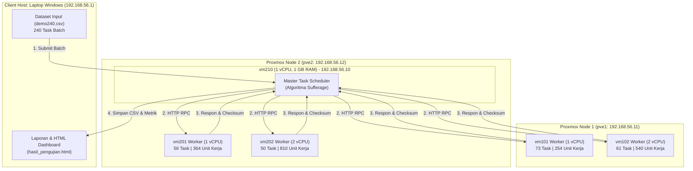

---

## 2. Diagram Logika Alur Algoritma Sufferage
Menjelaskan step-by-step bagaimana algoritma mengambil keputusan di VM210.

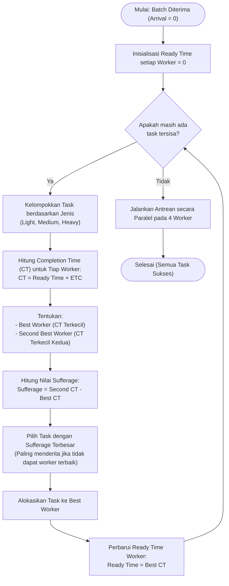

---

## 3. Komposisi Dataset Pengujian (Pie Chart)
Menampilkan proporsi 240 task: 120 ringan, 72 sedang, 48 berat.

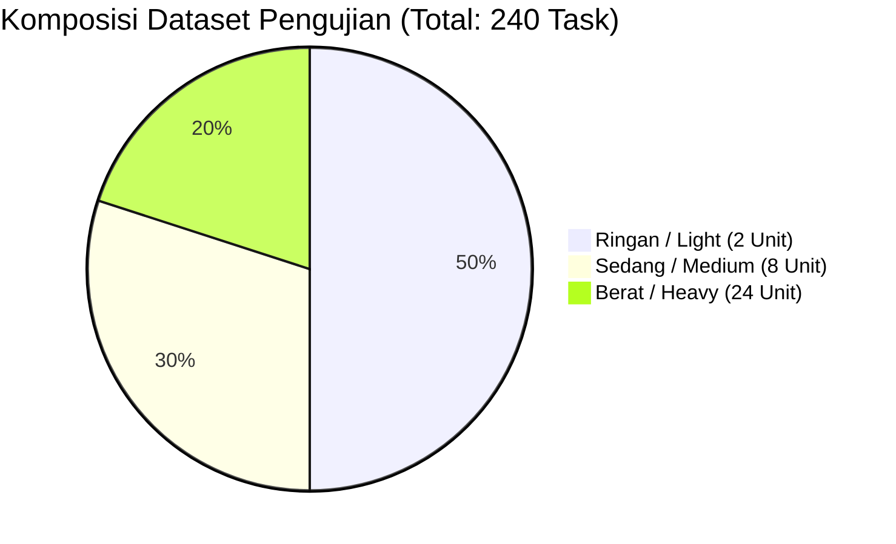

---

## 4. Distribusi Beban Komputasi / Unit Kerja per Worker (Pie Chart)
Menampilkan persentase pembagian total 1.968 unit kerja PBKDF2-SHA256 pada keempat worker.

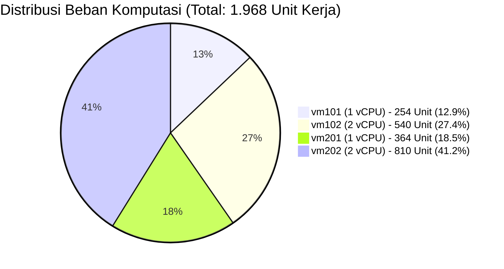

---

## 5. Total Alokasi Unit Kerja per Worker (Bar Chart)
Memperlihatkan bahwa VM dengan 2 vCPU (`vm102` & `vm202`) memikul 68,6% beban kerja.

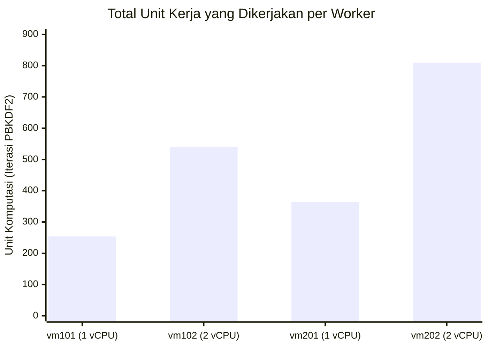

---

## 6. Jumlah Task yang Dialokasikan per Worker (Bar Chart)
Perbandingan jumlah task logis yang masuk ke masing-masing worker.

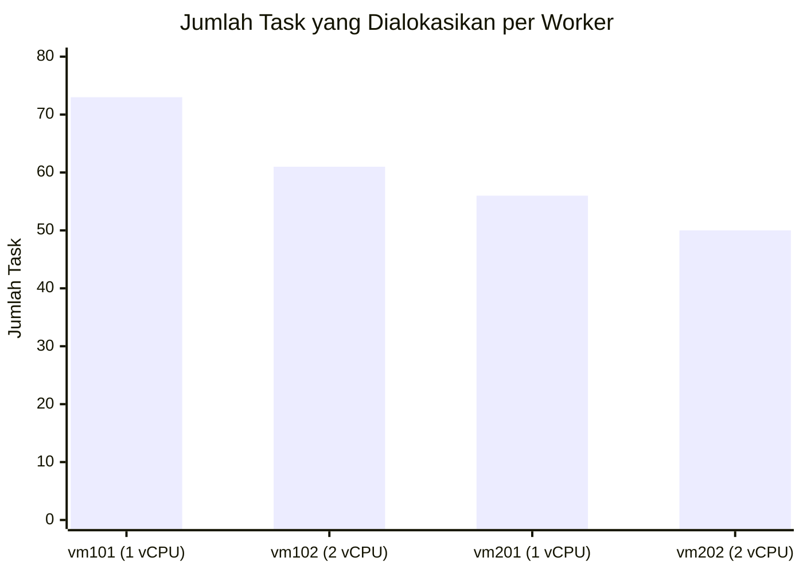

---

## 7. Rata-Rata Waktu Tunggu (Waiting Time) per Jenis Task (Bar Chart)
Bukti kuat cara kerja Sufferage: Task berat didahulukan sehingga waiting time-nya paling singkat!

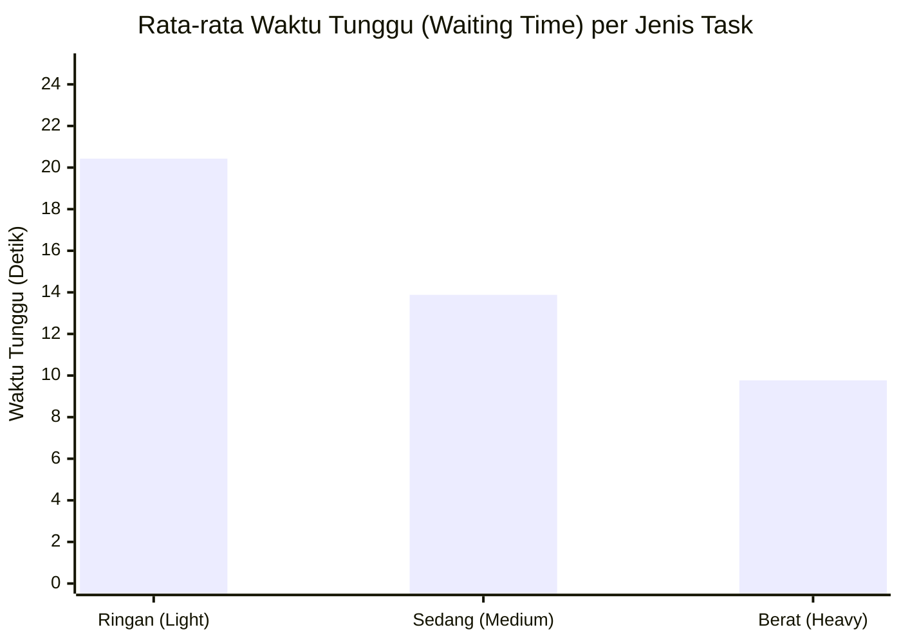

---

## 8. Rata-Rata Turnaround Time per Jenis Task (Bar Chart)
Turnaround time dihitung dari batch diterima ($t=0$) sampai task selesai ($Waiting + Execution$).

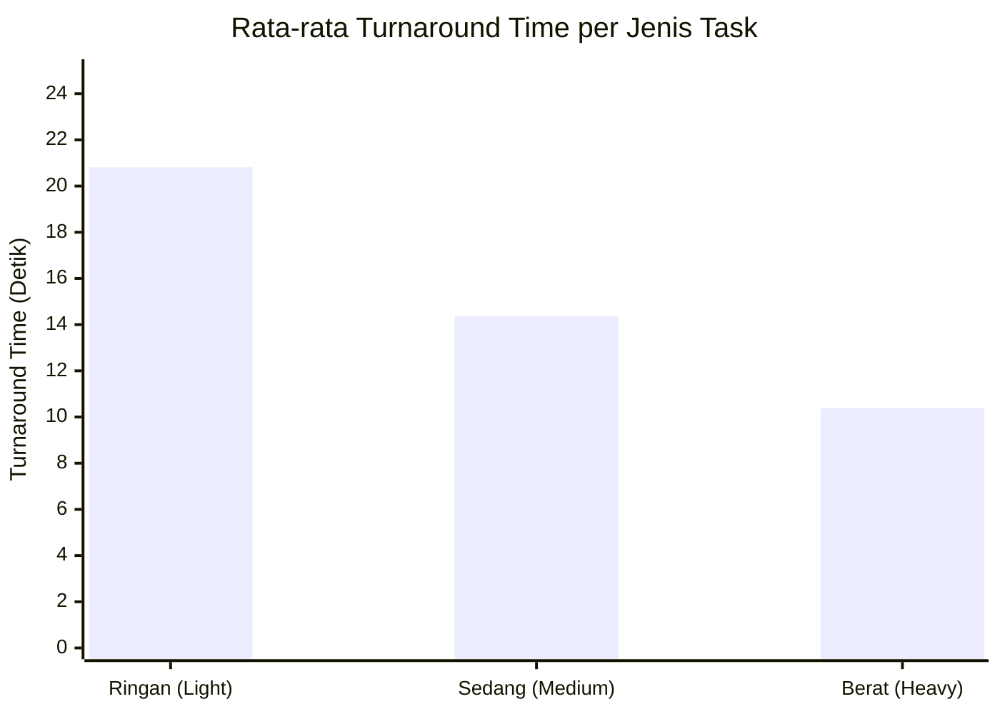

---

## 9. Perbandingan Prediksi Antrean vs Eksekusi Aktual vs Makespan (Bar Chart)
Evaluasi estimasi penjadwalan terhadap realitas sistem.

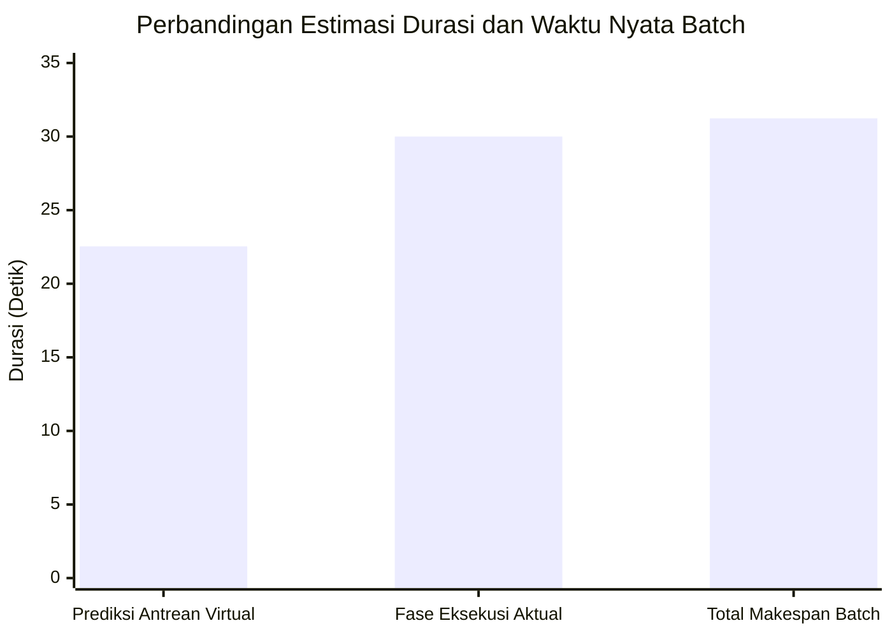

---

## 10. Utilisasi CPU Rata-Rata dan Puncak per Mesin (Bar Chart)
Penggunaan CPU guest dinormalisasi terhadap seluruh core yang dimiliki tiap VM.

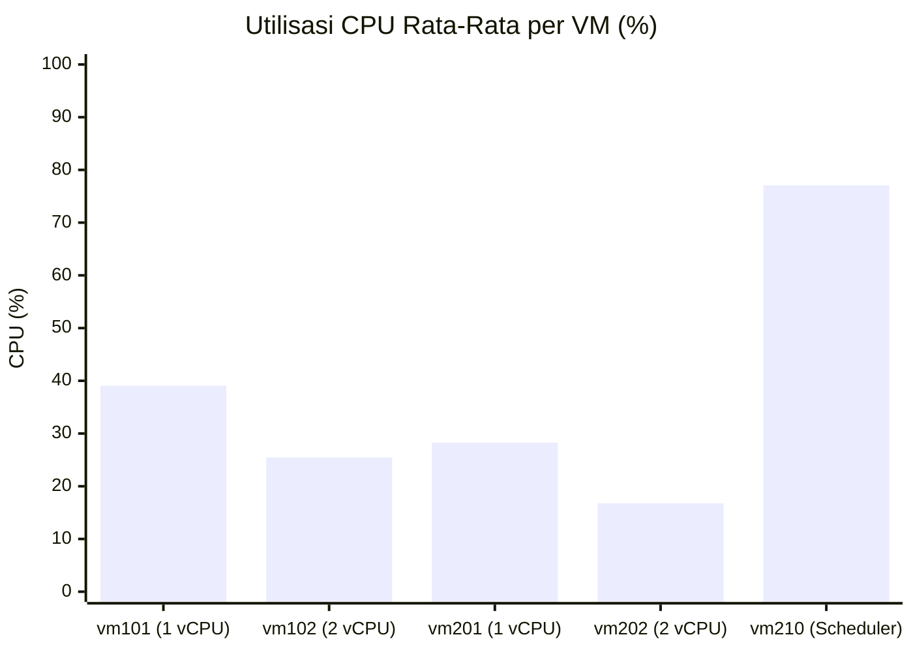

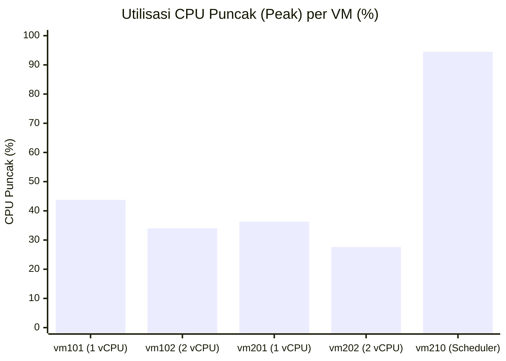

---

## 11. Utilisasi RAM Rata-Rata per Mesin (Bar Chart)
Penggunaan memori guest relatif stabil pada kisaran 19% - 23% (sangat hemat memori).

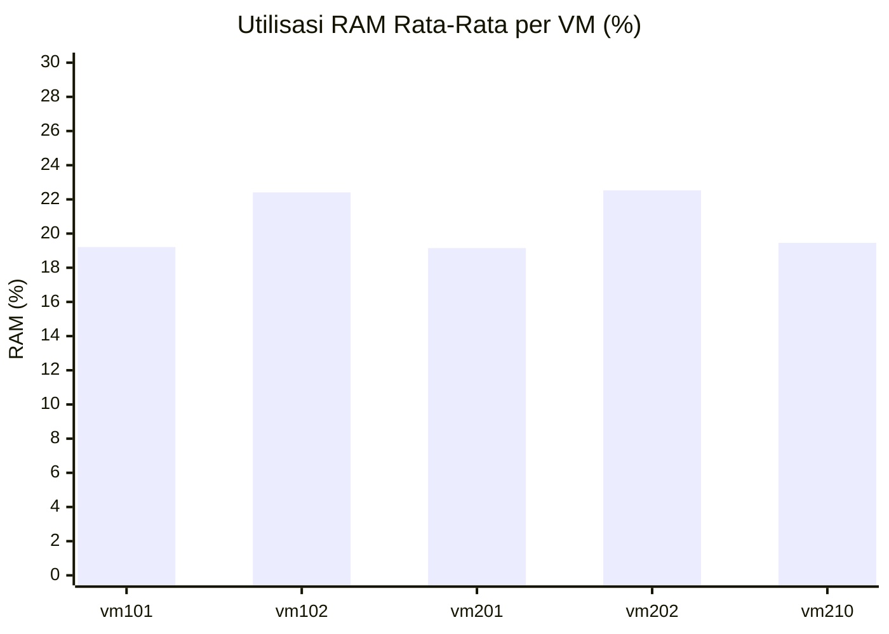

---

## 12. Estimasi Durasi Task Berat (Heavy) pada Matriks ETC (Bar Chart)
Memperlihatkan keunggulan VM 2 vCPU (`vm202` dan `vm102`) yang memproses task berat jauh lebih cepat dibanding VM 1 vCPU.

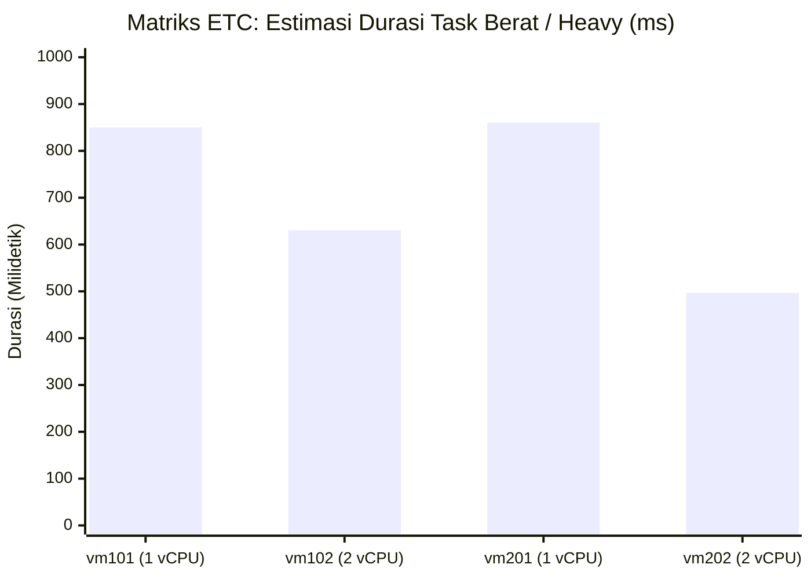

---

## 13. Timeline Eksekusi Antrean Worker (Gantt Chart)
Menampilkan fase eksekusi paralel pada keempat antrean worker hingga makespan tercapai di detik ke-31,24.

```mermaid
gantt
    title Timeline Eksekusi Batch 240 Task pada 4 Worker
    dateFormat X
    axisFormat %s s
    section Persiapan
    Planning Sufferage (0.67 s)       :done, 0, 1
    section Worker pve1
    vm101 (1 vCPU, 73 Task)           :active, 1, 30
    vm102 (2 vCPU, 61 Task)           :active, 1, 30
    section Worker pve2
    vm201 (1 vCPU, 56 Task)           :active, 1, 28
    vm202 (2 vCPU, 50 Task)           :active, 1, 28
    section Status Akhir
    Semua Task Selesai (31.24 s)      :crit, 30, 31
```

